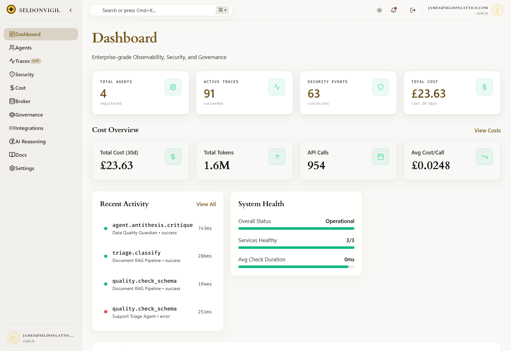
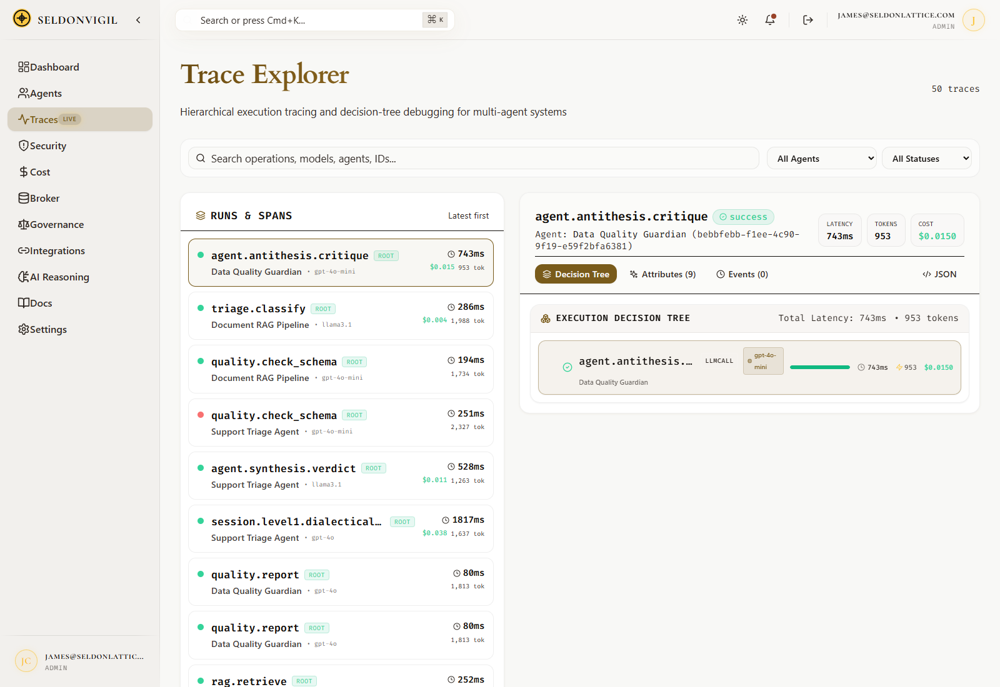
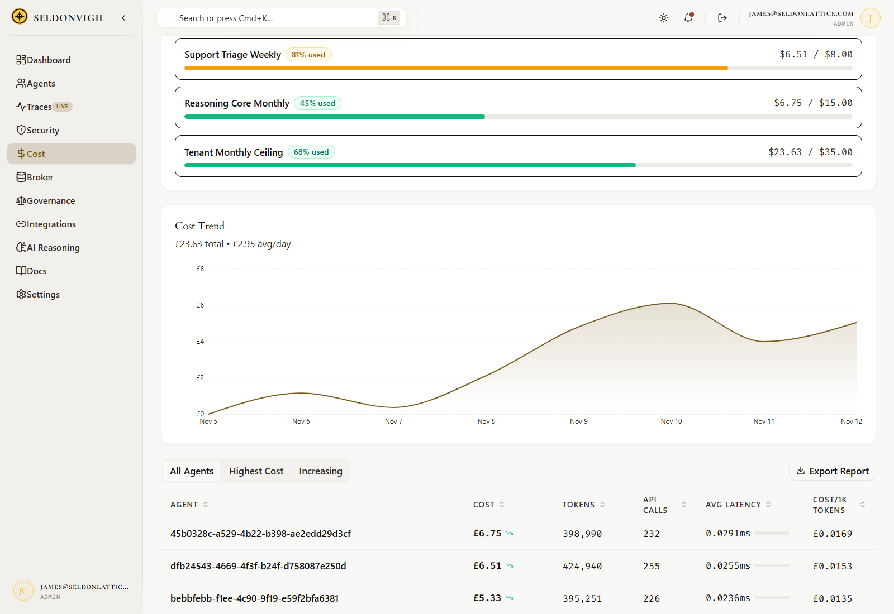
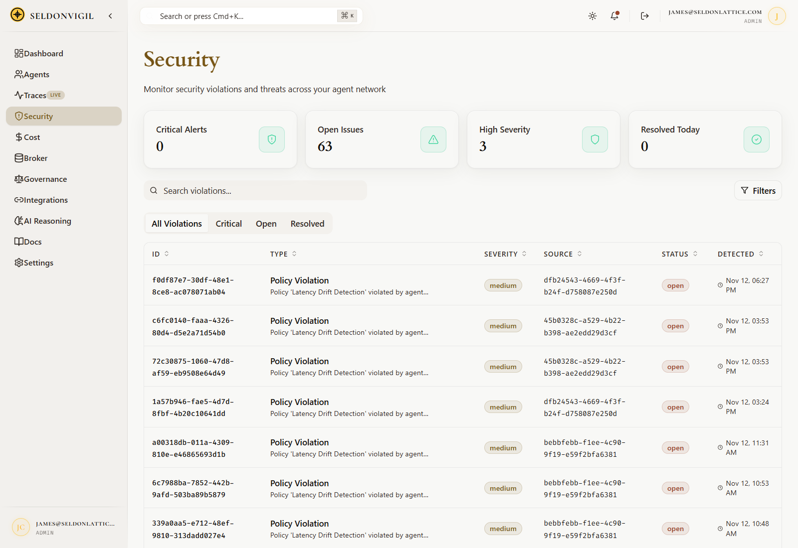
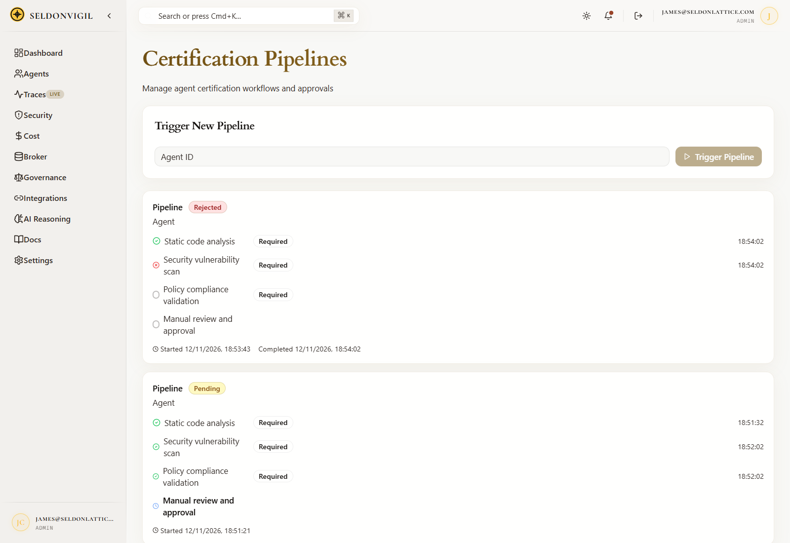
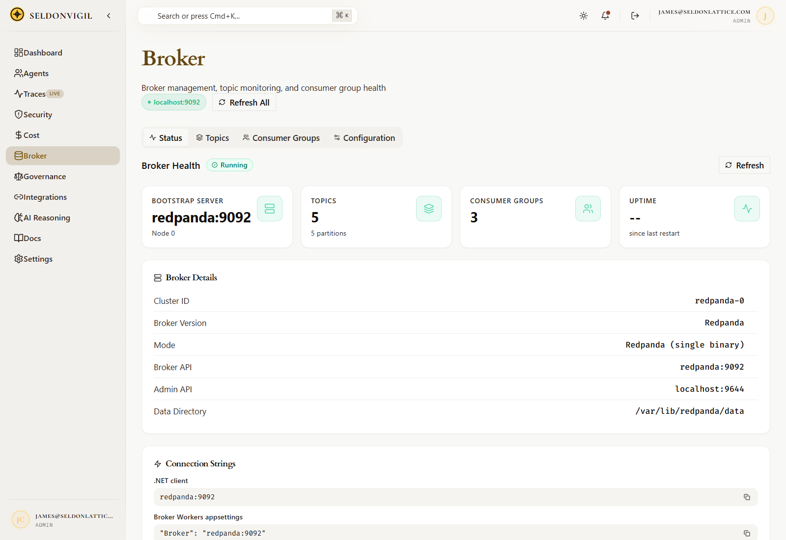

# SeldonVigil

**SeldonVigil** is an enterprise-grade observability, security, and governance platform for AI agent systems.

## Copyright

Copyright (c) 2026 ElenctiumLabs

## Architecture

SeldonVigil follows a modular monolith architecture with clear domain boundaries:

- **SeldonVigil.Api** - ASP.NET Core host with modular endpoints
- **SeldonVigil.Workers** - Background processing services
- **SeldonVigil.Sdk** - Client SDK for integration
- **SeldonVigil.Cli** - Command-line interface
- **SeldonVigil.SharedKernel** - Cross-cutting concerns
- **SeldonVigil.SourceGenerators** - Roslyn source generator projects (scaffolding)

## Quick Start

```bash
# Prerequisites: PostgreSQL 18+ running locally (localhost:5432)

# Start everything (Redpanda, Prometheus, the API, workers and the web UI)
# --project-name keeps the container and volume names stable (seldonvigil-*)
docker compose --project-name seldonvigil -f infrastructure/docker/docker-compose.yml up -d

# Open the web UI at http://localhost

# Or run the API and workers directly for local development (hot reload):
dotnet run --project src/SeldonVigil.Api
dotnet run --project src/SeldonVigil.Workers   # separate terminal

# Or run the frontend dev server (proxies /api to localhost:8080)
cd frontend && npm run dev

# Run tests
dotnet test
```

## Deployment

See [HOSTING_REQUIREMENTS.md](docs/HOSTING_REQUIREMENTS.md) for the self-hosted
Docker Compose setup, resource sizing, and the deployment checklist.

## Modules

| Module | Description |
|--------|-------------|
| Identity | Authentication & authorization |
| Observability | Tracing, metrics, logging |
| CostIntelligence | Cloud cost optimization |
| Security | Threat detection & posture |
| Governance | Policy enforcement & compliance |
| AIReasoning | Intelligent analysis |
| Analytics | Data processing & insights |
| Integration | Third-party connectors |
| Domain | Agent runtime: prompts, memory, tool orchestration, model routing |
| Messaging | Broker administration: topics, consumer groups, dead-letter routing |

## Screenshots

The application running from the Docker Compose stack with seeded demo data.

**Dashboard** — live agent, trace, security and cost metrics.



**Trace Explorer** — hierarchical execution tracing across agents, tools and LLM calls.



**Cost Intelligence** — spend against budget, with a daily trend and breakdowns by model and agent.



**Security** — policy violations with severity, source and status.



**Certification** — agent certification pipelines and their approval stages.



**Broker** — Redpanda topic and consumer-group health.



Further views: [agents](docs/images/agents.png), [governance](docs/images/governance.png),
[dashboard cost trend](docs/images/dashboard-cost-trend.png), [costs](docs/images/costs.png)
and [AI reasoning](docs/images/ai-reasoning.png).

## Development

```bash
# Format code
dotnet format
```

To run the full stack locally on Windows, see the
[WSL2 + Docker Environment](docs/development/wsl2-docker-environment.md) runbook.

## Documentation

The documentation lives in [`docs/`](docs) and is published as a page on the site
at `/docs` (also reachable from the **Docs** nav item). It is generated from the
markdown in that folder — edit a file, rebuild the web image, and the site
updates. See the [docs viewer](tools/docs-viewer/README.md) for details.

## License

MIT License - see [LICENSE](LICENSE) for details.

