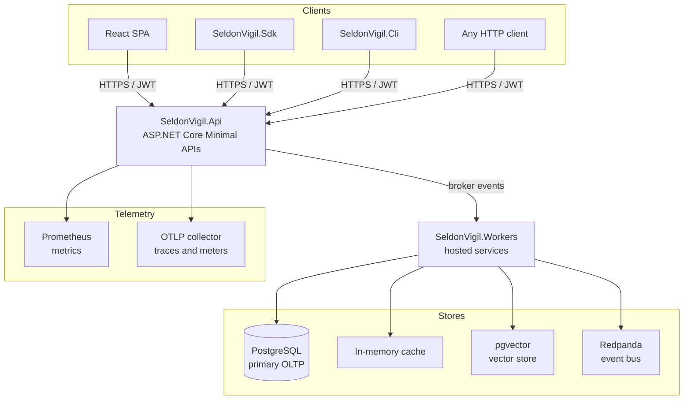

# Architecture

SeldonVigil is a **.NET 10 modular monolith**. A single deployable binary whose code is partitioned into independent modules, each owning its domain entities, MediatR handlers, and Minimal API endpoints.

> The open-source build consolidates persistence into a single `SeldonVigilDbContext` (PostgreSQL). The modules still own their own domain and application layers.

## Architectural patterns

| Pattern | Implementation |
|---|---|
| CQRS | Every action is a MediatR `ICommand` or `IQuery` |
| Domain-Driven Design | Each module: `Domain / Application / Infrastructure / Api` layers |
| Result pattern | Handlers return `Result<T>` — no exception-driven control flow |
| Event-driven | Domain events published to the broker, consumed by background workers |
| Minimal APIs | No MVC controllers — endpoint groups registered per module |
| Modular monolith | Strong module boundaries; persistence consolidated in one DbContext |

## Process boundary

| Process | Project | Role |
|---|---|---|
| API server | `src/SeldonVigil.Api` | HTTP request/response, JWT auth, module endpoints |
| Worker host | `src/SeldonVigil.Workers` | Broker consumers, periodic background jobs, no inbound HTTP |
